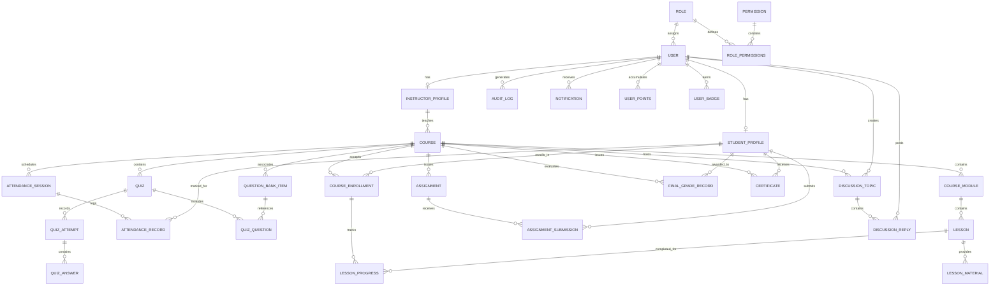

# Enterprise Learning Management System - Database Architecture

## 1. Database Model & Schema Overview

The Enterprise LMS utilizes **SQLAlchemy 2.0 ORM** with declarative models, explicit scoped sessions, and foreign key constraints.

Every domain model inherits from `ModelMixin` (`core/database.py`), providing:
* `id`: Integer primary key (Auto-incrementing indexed integer)
* `uuid`: String(36) globally unique identifier for external references and secure URLs
* `created_at`: Datetime UTC timestamp (Defaults to `datetime.utcnow`)
* `updated_at`: Datetime UTC timestamp (Auto-updates on entity modification)

---

## 2. Entity-Relationship Diagram (ERD)

---

## 3. Core Entity Tables & Field Specifications

### 3.1 Security & Identity
* **`roles`**: `id`, `uuid`, `name` (unique), `description`, `created_at`, `updated_at`
* **`permissions`**: `id`, `uuid`, `name` (unique), `description`, `category`, `created_at`
* **`role_permissions`**: `role_id` (FK), `permission_id` (FK)
* **`users`**: `id`, `uuid`, `username` (unique index), `email` (unique index), `password_hash`, `first_name`, `last_name`, `role_id` (FK), `status`, `is_active`, `failed_attempts`, `locked_until`, `last_login_at`
* **`student_profiles`**: `id`, `uuid`, `user_id` (FK, unique), `student_id_number` (unique), `enrollment_year`, `major`, `cumulative_gpa`, `academic_standing`
* **`instructor_profiles`**: `id`, `uuid`, `user_id` (FK, unique), `title`, `department`, `qualifications`, `expertise_areas`, `approval_status`

### 3.2 Curriculum & Learning
* **`courses`**: `id`, `uuid`, `code` (unique), `title`, `slug` (unique), `short_description`, `full_description`, `instructor_id` (FK), `category`, `difficulty`, `duration_hours`, `capacity`, `status` (`draft`, `pending_approval`, `published`, `archived`)
* **`course_modules`**: `id`, `uuid`, `course_id` (FK), `title`, `order_index`, `description`, `is_published`
* **`lessons`**: `id`, `uuid`, `module_id` (FK), `title`, `order_index`, `content` (Markdown/HTML), `summary`, `lesson_type` (`text`, `video`, `quiz`, `lab`), `duration_minutes`, `is_published`
* **`lesson_materials`**: `id`, `uuid`, `lesson_id` (FK), `title`, `material_type` (`document`, `code`, `link`), `file_path`, `url_link`

### 3.3 Enrollments & Attendance
* **`course_enrollments`**: `id`, `uuid`, `course_id` (FK), `student_id` (FK), `status` (`active`, `completed`, `dropped`), `progress_percentage`, `enrolled_at`, `completed_at`
* **`lesson_progress`**: `id`, `uuid`, `enrollment_id` (FK), `lesson_id` (FK), `status` (`not_started`, `in_progress`, `completed`), `completed_at`
* **`attendance_sessions`**: `id`, `uuid`, `course_id` (FK), `title`, `session_date`, `session_type`, `created_by` (FK)
* **`attendance_records`**: `id`, `uuid`, `session_id` (FK), `student_id` (FK), `status` (`present`, `late`, `absent`, `excused`), `notes`

### 3.4 Assessments & Grading
* **`question_bank`**: `id`, `uuid`, `course_id` (FK, optional), `prompt`, `question_type` (`mcq_single`, `mcq_multi`, `true_false`, `short_answer`), `options_json`, `correct_answers_json`, `explanation`, `marks`, `difficulty`
* **`quizzes`**: `id`, `uuid`, `course_id` (FK), `title`, `description`, `time_limit_minutes`, `passing_percentage`, `max_attempts`, `is_published`
* **`quiz_questions`**: `id`, `uuid`, `quiz_id` (FK), `question_id` (FK), `order_index`, `marks`
* **`quiz_attempts`**: `id`, `uuid`, `quiz_id` (FK), `student_id` (FK), `score`, `total_marks`, `percentage`, `passed`, `started_at`, `submitted_at`
* **`quiz_answers`**: `id`, `uuid`, `attempt_id` (FK), `question_id` (FK), `student_answer_json`, `is_correct`, `marks_awarded`
* **`assignments`**: `id`, `uuid`, `course_id` (FK), `title`, `instructions`, `due_date`, `max_marks`, `passing_marks`, `rubric_json`
* **`assignment_submissions`**: `id`, `uuid`, `assignment_id` (FK), `student_id` (FK), `submission_text`, `attachment_url`, `score`, `letter_grade`, `status`, `submitted_at`, `graded_at`
* **`final_grade_records`**: `id`, `uuid`, `course_id` (FK), `student_id` (FK), `coursework_score`, `quiz_score`, `exam_score`, `final_score`, `letter_grade`, `grade_points`, `passed`

### 3.5 Credentials & Gamification
* **`certificates`**: `id`, `uuid`, `certificate_code` (unique index), `course_id` (FK), `student_id` (FK), `pdf_file_path`, `issued_at`, `is_revoked`, `verification_url`
* **`badges`**: `id`, `uuid`, `name` (unique), `code` (unique), `description`, `icon_name`, `xp_reward`
* **`user_badges`**: `id`, `uuid`, `user_id` (FK), `badge_id` (FK), `awarded_at`
* **`user_points`**: `id`, `uuid`, `user_id` (FK, unique), `total_points`, `current_level`, `current_streak_days`, `last_activity_date`

---

## 4. Indexing & Optimization Strategy

1. **Unique Lookup Indexes**:
   - `users.username`, `users.email`
   - `courses.code`, `courses.slug`
   - `certificates.certificate_code`
2. **Composite Query Indexes**:
   - `(course_enrollments.course_id, course_enrollments.student_id)`
   - `(lesson_progress.enrollment_id, lesson_progress.lesson_id)`
   - `(attendance_records.session_id, attendance_records.student_id)`
3. **Foreign Key Indexes**:
   - All foreign keys are indexed by default in SQLAlchemy to ensure sub-millisecond joins.
